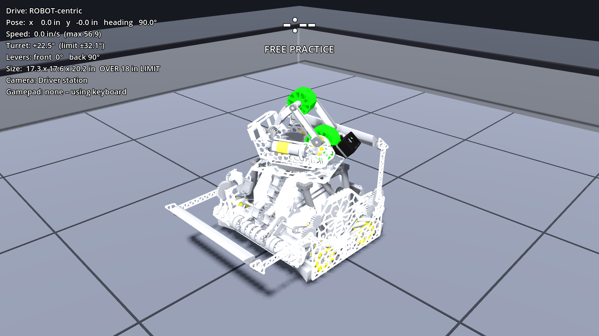

# BIOBUZZ FTC Simulator (Godot 4)

Driver practice and (later) real-OpMode testing for our FTC robot.



## Run it
1. Install **Godot 4.5 or newer** (standard version, not .NET): https://godotengine.org/download
2. Open Godot → **Import** → pick this folder's `project.godot` → **Run** (F5 key in the editor, or the ▶ button).
3. Plug in a USB gamepad (Xbox / PlayStation / Logitech all work). No gamepad? Use the keyboard.

| Action | Gamepad | Keyboard |
|---|---|---|
| Drive / strafe | Left stick | W A S D |
| Turn | Right stick X | Q / E |
| Slow mode (hold) | Left bumper | Shift |
| Robot-centric ↔ field-centric | Y | F |
| Reset field-centric "forward" to where the robot faces now | X | H |
| Start a 2:00 driver-controlled match | Start | Enter |
| Start a full match (30 s auto → transition → 2:00) | – | M |
| Front intake (side A) / back intake (hold) | Right trigger / left trigger | I / K |
| Reverse the intakes (hold with the above) | Left-stick click | Ctrl |
| Shooter flywheel on / off | Right bumper | G |
| Hood up / down | D-pad ↑ / ↓ | ↑ / ↓ |
| Turret auto-aim on / off | Right-stick click | T |
| Turret by hand (switches auto-aim off) | D-pad ← / → | Z / X |
| Front lever / back lever (toggle) | A / B | 1 / 2 |
| Show the collision box | – | V |
| Reset robot + clock | Back | R |
| Next camera (driver station / top-down / chase) | – | C |
| Reload `robot_config.json` | – | F5 |

With no match running you are in free practice (no clock).

## Changing robot numbers
Everything lives in **`robot_config.json`**: dimensions, wheel size, motor RPM, track width,
acceleration limits, match times. Edit it, save, press F5 in the running sim. Placeholder
values are listed at the top of that file.

## The robot model (CAD)
The Onshape export lives in `cad/Robot.glb` (93 MB, far too heavy to animate directly).
`tools/process_cad.mjs` turns it into four light pieces in `models/` (chassis, turret, front
lever, back lever; about 12 MB together), each with its origin on its pivot, and writes the
sizes and pivot positions it measured to `models/measurements.json`.

**When the CAD changes:** export the top-level assembly from Onshape as glTF (`.glb`), replace
`cad/Robot.glb`, then:
```bash
cd tools
npm install
npm run cad
```
Copy any changed numbers from `models/measurements.json` into `robot_config.json`. The tool finds
things by part name (`Mecanum Wheel`, `Spur gear (70 teeth)`, the `Patita` / `Torreta` / `Chasis`
groups), so keep those names in Onshape.

The turret turns a full 360° with no end stops (`turret.continuous`; set it to `false` to get the
±32° that a 300° servo gives through the 15:70 gears). With auto-aim on, it keeps the shooter
pointed at the AprilTag under the raised cell of your alliance's hive. A green dotted arc shows
where a shot would go with the current flywheel speed and hood angle. The hood part itself is not
animated; the arc is how you see it move.
Levers go 0° (stowed) to 90° (deployed). Both move at a limited speed set in the config.
Known limit: deployed levers do not collide with anything yet; only the chassis box does.

## Pollen, intakes and shooter
- **Pollen** are real physics balls (3 in). The robot pushes them around; they never block it.
- **Intakes:** a ball touching an intake mouth while that intake motor runs is swallowed into
  that side's feeder. The robot holds at most `intakes.total_capacity` balls.
- **Feeders and shooter:** each intake motor also runs its feeder, carrying balls up to the shared
  neck. A ball at the neck waits there until the flywheel is spinning *and* its intake motor
  runs; then it is launched out of the turret's Limelight side at the hood angle. Each shot
  slows the flywheel a little.

## The field
The floor plan is the real BIOBUZZ one: it is read from `data/field_layout.json` and
`data/game_elements.json`, which come from the BEE simulator (see `data/README.md`). That gives
the loading zones, gardens, the four flowers (4 pollen each), the hive frame, the red and blue hive
cells, and where every pollen starts. The robot starts with 4 pollen loaded.

The hives and their A-frame are the real AndyMark models (`cad/field/red_hive.glb`,
`blue_hive.glb`, `hive_frame.glb`, slimmed by `tools/process_field.mjs` with `npm run field`).
Each hive is a seesaw on top of the frame, 43 in above the floor: two tunnel-shaped cells on a
centre pivot, each open at its outer end. Pollen and the robot collide with the real shapes, and
the robot can drive under the hives between the frame legs.

**Hive rule:** when the raised cell holds 8 pollen the seesaw tips. The pollen inside at that
moment are scored for that alliance; they then roll out of the lowered cell and the other cell
becomes the raised one. Pollen that left the cell before the tip do not count. The HUD shows the
balls in each cell and the score.

**Flowers:** a deployed lever held against a flower works as a wedge and the flower drops its
pollen to the floor, one at a time. The flowers are still plain cylinders.

Still **guesses** (in `robot_config.json` under `field`): the hive's tilt angle and tip time, the
flower height, and how close the lever must be. Nectar is not modelled.

The driver stands behind the red wall (left) by default; set `driver.alliance` to `blue` to switch.

All speeds, capacities and angles here are placeholders in `robot_config.json`.

## How the driving works
`scripts/robot.gd` takes four wheel powers (-1..1, like `motor.setPower()`), converts them to a
chassis velocity with the mecanum equations, applies acceleration limits, and moves a collision
box. Top speed = motor RPM × wheel circumference × `loaded_speed_fraction`. It also tracks
wheel encoder ticks for the Java bridge in Phase 4. `scripts/builtin_teleop.gd` is the built-in
TeleOp that turns sticks into those wheel powers.

Coordinates shown on the HUD are FTC-style: inches, origin at field centre, heading
counter-clockwise. Red wall is −x, blue wall is +x, audience is −y.

## Self-test
```bash
godot --headless -s tests/test_drive.gd
```

## Roadmap
1. ✅ Driver practice MVP
2. ✅ Real robot CAD model (turret + lever pivots)
3. ✅ Pollen, intakes, shooter, turret/lever controls, BIOBUZZ field layout (heights and hive/flower behaviour still guesses)
4. Java sim SDK + WebSocket bridge (run real OpModes)
5. Odometry + IMU, sample autonomous
6. Limelight sim
